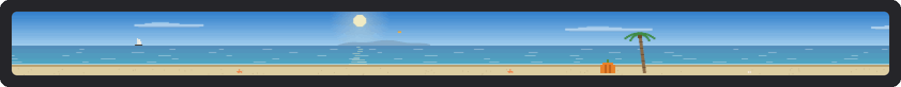
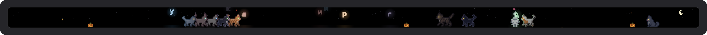
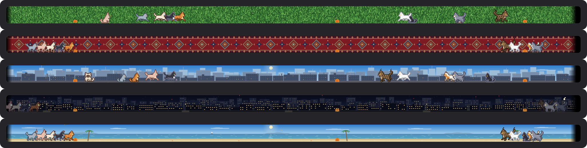

<p align="center">
  
</p>

<h1 align="center">TouchBar Cats</h1>

<p align="center">
  Восемнадцать пиксельных котиков живут на Touch Bar вашего MacBook Pro.<br>
  Ловят буквы, которые вы печатаете, и прибегают на «кс кс кс».
</p>

<p align="center">
  🇬🇧 <b>English speaker?</b> The English guide is at the very bottom of this page — <a href="#english">jump to English ↓</a>
</p>

<p align="center">
  <a href="https://github.com/tsanatsan/touchbar-cats/releases/latest/download/TouchBar-Cats.zip"></a>
</p>

<p align="center">
  
  
  
  
</p>

<p align="center">
  <a href="#как-установить">Как установить</a> ·
  <a href="#что-умеют-котики">Что умеют котики</a> ·
  <a href="#котики">Знакомьтесь</a> ·
  <a href="#фоны">Фоны</a> ·
  <a href="#полезное">Полезное</a> ·
  <a href="#откуда-это">Откуда это</a> ·
  <a href="#english">English</a>
</p>

---

## Как установить

Займёт пять минут, программировать не нужно. Подойдёт любой MacBook Pro с Touch Bar — полоской-экраном над цифрами.

**1. Скачайте программу.** Нажмите оранжевую кнопку «Скачать» вверху. Скачается архив `TouchBar-Cats.zip`.

**2. Распакуйте.** Откройте папку «Загрузки» и дважды щёлкните по архиву. Рядом появится программа **TouchBar Cats** с котиком на значке. Если Safari уже распаковал архив сам, этот шаг можно пропустить.

**3. Перенесите её в «Программы».** Перетащите TouchBar Cats мышкой в папку «Программы» в левой колонке окна Finder.

**4. Откройте её в первый раз.** Дважды щёлкните по TouchBar Cats. Mac скажет, что не смог проверить программу. Это нормально: программа бесплатная, и автор не платил Apple за проверку. Нажмите **«Готово»**.

**5. Разрешите её запуск.** Откройте «Системные настройки» → **«Конфиденциальность и безопасность»** и пролистайте вниз до раздела «Безопасность». Там будет строчка про TouchBar Cats и кнопка **«Всё равно открыть»**. Нажмите её и подтвердите паролем или отпечатком пальца. Это нужно сделать только один раз.

**6. Разрешите котикам видеть клавиатуру.** Программа попросит доступ «Универсального доступа». Нажмите **«Открыть Системные настройки»** и включите переключатель рядом с TouchBar Cats. Без этого коты будут жить на тачбаре, но буквы летать не будут. Если окошко не появилось: «Системные настройки» → «Конфиденциальность и безопасность» → «Универсальный доступ».

**7. Готово!** Коты выбегут на тачбар с краёв. Попечатайте что-нибудь, а потом напишите «кс кс кс».

> **Нужны яркость, громкость и обычные кнопки?** Нажмите вместе **⌃ Control + ⌥ Option + ⌘ Command + T**. Коты разбегутся, и появится обычный тачбар. То же сочетание возвращает котов.

<details>
<summary><b>Как выключить или удалить</b></summary>

<br>

- **Выключить:** вверху экрана, в строке меню, есть значок с сидящим котиком. Нажмите на него и выберите **«Выйти»**.
- **Запускать вместе с Mac:** в том же меню откройте **«Настройки»** и включите **«Открывать при входе»**.
- **Удалить:** выключите программу, перетащите TouchBar Cats из «Программ» в корзину, а в «Универсальном доступе» уберите её строчку кнопкой «−».

</details>

## Что умеют котики

### Буквы-светлячки


Каждая буква, которую вы нажимаете, вылетает на тачбаре прямо над своей клавишей: «й» слева, «ж» справа. Буква светится, как светлячок, и подсвечивает шерсть котов вокруг. Ближайший игривый кот подкрадывается, виляет попой и прыгает. Поймал — буква рассыпается искрами, а кот довольно жуёт.

С 23:00 до 7:00 наступает ночь: на тачбаре загораются звёзды и луна, коты в основном спят, а глаза у них светятся в темноте.

### «кс кс кс»

Напишите «кс», и коты навострят уши. С каждым следующим «кс» они подходят ближе: поворачиваются мордочками к вам и растут, пока не прижмутся к стеклу. Там они моргают, тянутся к вам и трогают стекло лапкой с розовыми подушечками. Перестанете писать — через пару секунд коты отойдут и вернутся к своим делам.

### Backspace и «мяу»


Стёрли букву — она падает на пол, и ближайший кот сбивает её лапой. Напишите «мяу», и кто-нибудь ответит.

### Клубок


Напишите «клубок» или дважды коснитесь тачбара в любом месте: туда сверху упадёт клубок, и коты будут его гонять. Смахните клубок пальцем, и он покатится. Смахнёте сильно — улетит за край тачбара.

### Лазер от тачпада



Ведите пальцем по тачпаду, как обычно двигаете курсор, и прямо над тачпадом на тачбаре появится красная точка. Влево-вправо она ходит вместе с пальцем, а к дальнему краю тачпада поднимается вверх. Коты гоняются за ней: у пола бьют лапой или прыгают сверху, в воздухе встают на задние лапы и ловят двумя лапками или прыгают до точки. Отпустили палец — коты не замирают, а по инерции пробегают ещё немного и тормозят каждый по-своему. Выключается в «Настройках» → «Лазер от тачпада».

### Игрушки

- **Мышка.** Иногда сама пробегает по краю, а ещё её можно позвать словом «мышка». Коты устраивают облаву; поймают не всегда.
- **Коробка.** Напишите «коробка» — коты по очереди залезают внутрь, из коробки торчат только головы. Толстые Пончик и Ириска застревают.
- **Миска.** Напишите «рыба» или «еда» — коты сбегаются к миске и едят.

### Времена года и праздники

Зимой идёт снег, весной летят лепестки, летом порхают бабочки, осенью падают листья. На Новый год коты носят красные шапочки, на Хэллоуин у края стоят тыквы, светящиеся ночью, и летают летучие мыши, на День святого Валентина всплывают сердечки. Всё по дате на Mac, без интернета. Выключается в «Настройках».

### Цвет букв



«Котики» → **«Цвет букв»**: светлячок (жёлто-зелёный, как было), розовый, голубой, сиреневый, золотой, мятный или радуга, где каждая новая буква следующего цвета. Цвет меняется целиком: свечение, шлейф, искры и даже отсвет на шерсти котов.

### Фоны



«Котики» → **«Фон»**:
- **чёрный** — как стекло тачбара;
- **трава** — газон на весь тачбар, с клевером и ромашками;
- **ковёр** — бордовый, с каймой и медальонами, как висел на стене у бабушки;
- **город** — дома уходят вдаль, в дымку;
- **пляж** — море до горизонта, острова, парусник, пальмы.

Город и пляж живут по часам на Mac: рассвет, утро, полдень, день, закат, сумерки и ночь. Солнце встаёт слева и садится справа, на закате небо розовеет, ночью в домах зажигаются окна и фонари, а по воде бегут блики. Трава и ковёр ночью просто темнеют.

### Облака вместо котиков

Меню **«Облака»** → **«Облака вместо котиков»**: коты убегают с тачбара, и на нём плывут пиксельные облака. Слои движутся с разной скоростью, дальние медленнее, поэтому у неба есть глубина. Двигает их сама macOS (Core Animation) плавно, с частотой экрана, а программа в это время почти не тратит процессор.

- **Свайп одним пальцем** по тачбару — другие облака. Следующие тянутся за пальцем, как карусель, и на секунду показывается название. Всего 28 вариантов: от ясного дня и розовой ваты до заката, грозы и лунной ночи.
- **Громкость двумя пальцами и яркость тремя** работают и здесь.
- **«Облака плывут»** можно выключить: тогда небо стоит на месте.
- **«Загрузить свои облака…»** — любые картинки, папка или zip-архив. Папка со слоями `1.png`, `2.png`… превращается в одно небо с глубиной.

Облака — бесплатный набор [CraftPix](https://craftpix.net/freebies/free-sky-with-clouds-background-pixel-art-set/). Лицензия разрешает использовать их внутри программы, но не раздавать сами картинки, поэтому в репозитории их нет: они упакованы только в готовую программу в релизах.

## Котики

<p align="center">
  
  
</p>

| | Кто | Характер |
|---|---|---|
| **Рыжик** | рыжий полосатый, «М» на лбу | самый азартный охотник |
| **Уголёк** | чёрный | огромные жёлтые глаза, ночью светятся |
| **Фрак** | смокинг | белая манишка, белые лапки |
| **Ириска** | трёхцветная толстушка | соня, ходит вразвалочку |
| **Сима** | сиамская | тёмная маска, голубые раскосые глаза |
| **Пончик** | толстый серо-белый | почти всё время спит |
| **Добби** | сфинкс | лысый, огромные уши, морщинки |
| **Барон** | мейн-кун | самый большой, кисточки на ушах, грива |
| **Пуговка** | вислоухая | круглая мордочка, совиные глаза |
| **Снежок** | белый пушистый | глаза разного цвета |
| **Персик** | кремовый полосатый | ласковый, всегда рядом |
| **Дымка** | русская голубая | изящная, зелёные глаза |
| **Тигра** | серый тигровый | охотник не хуже Рыжика |
| **Мурка** | черепаховая | рыже-чёрные пятна |
| **Бусинка** | бело-рыжая | маленькая и шустрая |
| **Шоколадка** | шоколадная | янтарные глаза |
| **Граф** | толстый британец | важный, медленный, медные глаза |
| **Чита** | бенгальская | самая быстрая |

Все 18 живут на тачбаре сразу. Лишних можно отправить погулять: «Котики» → «Кто на тачбаре» или «Убрать котика». Коты гуляют, умываются, спят клубком, потягиваются, зевают и трутся носами друг о друга. Задержите палец на тачбаре — ближайшие подойдут ласкаться.

## Свой кот из фото

Пока на доработке: переделываю его под новых нарисованных котов. Коты, которых вы уже сделали из фото, и котята сохранены и вернутся вместе с этой функцией.

## Полезное

- **Помидорный таймер.** Напишите «кот 25» — кот проспит 25 минут, над ним видно, сколько осталось, а потом он проснётся и позовёт на перерыв. «кот 0» отменяет.
- **Батарея.** Мало заряда — коты вялые и много спят. Подключили зарядку — кто-то перебирается к левому краю, где порт, и греется.
- **Статистика.** В меню «Котики» видно, сколько букв вы напечатали сегодня, сколько поймали коты, скорость печати в знаках в минуту и рекорды. Хранятся только счётчики, сами буквы нигде не сохраняются.
- **Звуки.** Тихое мурчание, когда гладите, «мррп», когда кот поймал букву, и «мяу» в ответ. По умолчанию выключены, включаются в «Настройках».
- **GIF тачбара.** «Котики» → «Записать GIF (5 секунд)» — пять секунд тачбара сохранятся на рабочий стол как GIF в аккуратной рамке, готовый для чатов и сторис. Пока идёт запись, в углу тачбара горит красная точка (в GIF она не попадает).

## Слова и касания

Слово срабатывает после пробела или просто после короткой паузы. Когда коты его поняли, буквы слова рассыпаются искрами.

| Напечатайте | Что будет |
|---|---|
| любую букву | светлячок над её клавишей, коты охотятся |
| «кс», ещё «кс», ещё… | коты подходят к стеклу, с каждым разом ближе |
| «мяу» | кот отвечает |
| «клубок» | сверху падает клубок |
| «рыба» или «еда» | миска, все бегут есть |
| «коробка» | коробка, коты лезут внутрь |
| «мышка» | пробегает мышь |
| «привет» | коты машут лапой |
| «фу» | обижаются и отворачиваются |
| «спать» | все засыпают |
| имя кота | подходит только он |
| «кот 25» | помидорный таймер на 25 минут |
| Backspace | кот сбивает стёртую букву |
| пробел | облачко огоньков |

| Сделайте пальцем | Что будет |
|---|---|
| задержите или ведите палец | ближайшие коты подходят ласкаться и идут за пальцем |
| медленно проведите над котом | вы его гладите: жмурится, сердечки, говорит своё имя |
| коснитесь спящего | вздрагивает и просыпается |
| коснитесь мордочки у стекла | «буп» и румяные щёчки |
| дважды коснитесь где угодно | туда падает клубок |
| смахните клубок | клубок катится, можно выбить его даже у кота из зубов |
| сильно смахните клубок | улетает за край |
| дважды коснитесь клубка | кот уносит его в зубах |
| ведите пальцем по тачпаду | лазерная указка над тачпадом |

**Меню.** Нажмите на значок с котиком в строке меню:

- **«Обычный тачбар»** — то же, что ⌃⌥⌘T;
- **«Котики»** — статистика за сегодня, добавить или убрать котика, **«Кто на тачбаре»**, **«Фон»**, **«Цвет букв»**, **«День и ночь»** и запись GIF;
- **«Облака»** — облака вместо котиков;
- **«Настройки»** — запуск при входе и **язык: русский или английский**, потом коротко про котиков (лазер, сезоны, звуки) и про тачбар (жесты громкости и яркости, полоса управления, тактильный отклик, скрыть котов в текущей программе); файл конфига — в «Для продвинутых»;
- **«Выйти»**.

## Это безопасно?

- Буквы только рисуются на тачбаре. Программа их никуда не записывает и не отправляет.
- В интернет программа не ходит вообще.
- В полях для паролей macOS сама прячет нажатия от всех программ, так что пароли на тачбар не попадут.
- Сочетания с ⌘, ⌃ и ⌥ светлячками не становятся.
- Батарею коты почти не едят: около 8% одного ядра со всеми 18 котами на MacBook Pro M1, примерно как вкладка браузера с лёгкой анимацией. Нужно совсем ноль — включите обычный тачбар по ⌃⌥⌘T, коты встанут на паузу.
- Весь код открыт, его можно прочитать в этом репозитории.

## Откуда это

Я хотел вырастить на тачбаре что-нибудь живое. Самый простой путь к тачбару оказался в [MTMR](https://github.com/Toxblh/MTMR) («My TouchBar My Rules») Антона Пальгунова: это открытая программа, которая уже умеет занимать весь тачбар. Я взял её за основу, вырезал почти всё, что в ней было — автообновление, погоду, курсы валют, лишние разрешения — и поселил туда котов.

**Огромное спасибо Антону Пальгунову и всем, кто делал MTMR, за то, что выложили код в открытый доступ.** Без них этой забавы бы не было.

**Котов нарисовал [Last tick](https://last-tick.itch.io)**: это бесплатный набор [32x32 Pixel kittens Cats](https://last-tick.itch.io/animated-pixel-kittens-cats-32x32). Программа берёт оттуда одного кота со всеми его анимациями и сама перекрашивает и переделывает его под каждую из 18 пород. Спасибо за таких живых и милых котиков!

TouchBar Cats я раздаю точно так же: бесплатно и с открытым кодом под лицензией [MIT](LICENSE). Берите, меняйте, дарите своим котам.

> **Графика котов и облаков — не под MIT.** Под MIT только код этого репозитория. Котов Last tick и облака [CraftPix](https://craftpix.net/freebies/free-sky-with-clouds-background-pixel-art-set/) можно использовать внутри программы, но нельзя раздавать сами файлы, ни исходные, ни изменённые. Поэтому их нет в репозитории: они упакованы только в готовую программу. Если собираете из исходников, скачайте наборы со страниц авторов и положите их, как описано в «Для разработчиков» ниже — без них коты рисуются прежним способом.

<details>
<summary><b>Для разработчиков: сборка из исходников и настройка</b></summary>

<br>

Xcode не нужен, хватит Command Line Tools:

```bash
xcode-select --install
```

```bash
git clone https://github.com/tsanatsan/touchbar-cats.git
cd touchbar-cats
make run
```

Коты рисуются по листу спрайтов из папки `../cat-art` (файл `CatBase.png`, или `CAT_ART=путь make`), собранному из набора [Last tick](https://last-tick.itch.io/animated-pixel-kittens-cats-32x32): один кот на 59 анимаций, которого программа сама перекрашивает и переделывает под каждую породу. Этот лист, как и облака, можно класть только внутрь программы, поэтому в репозитории его нет. Без него коты рисуются прежним способом. Облака при сборке берутся из папки `../clouds-art` рядом с репозиторием (или `CLOUDS_ART=путь make`). Если её нет, режим облаков показывает только загруженные из меню. `make install` копирует программу в «Программы», `make release` собирает универсальный архив для Apple Silicon и Intel, `ARCH=x86_64 make` — сборку только под Intel. Подпись сборки привязана к идентификатору программы, поэтому разрешение «Универсального доступа» не слетает после пересборки.

**Конфиг** лежит в `~/Library/Application Support/MTMR/items.json`, формат тот же, что у MTMR. По умолчанию там только коты:

```json
[
  { "type": "cats" }
]
```

Котов можно сузить и поставить рядом другие элементы MTMR. Например, громкость и яркость: здесь это одна кнопка, как в полосе управления Apple — коснулся и ведёшь пальцем.

```json
[
  { "type": "cats", "width": 760 },
  { "type": "brightness", "align": "right" },
  { "type": "volume", "align": "right" }
]
```

Остальные виджеты MTMR описаны в [его README](https://github.com/Toxblh/MTMR#readme).

**Где что лежит:**

- `MTMR/Cats/` — коты: породы и окрасы, пиксельные позы, поведение, отрисовка со светом от букв, элемент тачбара, мастерская своих котов и разбор фото через Vision (пока выключены: `ownCatsFrozen` в `CatBreeds.swift`);
- `MTMR/Widgets/ControlStripSliderItem.swift` — громкость и яркость в стиле Apple;
- `MTMR/GlobalHotKey.swift` — сочетание ⌃⌥⌘T;
- `build-local.sh` — сборка без Xcode.

Каждый кот и каждая буква собираются в маленькую картинку в памяти и выводятся на тачбар одной командой, а фон рисуется заранее и обновляется раз в 10 минут. Всё сразу рисуется в цветовом пространстве тачбара (Display P3), чтобы системе не приходилось пересчитывать цвета каждого пикселя. Тачбар обновляется 60 раз в секунду, только когда что-то происходит (летят буквы, касание, прыжок, «кс кс»), на батарее — 30. Пока коты просто гуляют — 20, когда все отдыхают — 10, а на паузе и пока экран спит — раз в секунду.

</details>

## Ограничения

- Проверено на MacBook Pro 13″ с M1 и macOS 26 Tahoe. Версия для Intel собирается, но на Intel-Маке не проверялась.
- Буквы стоят точно над клавишами на 13-дюймовом MacBook Pro: у него Esc слева и Touch ID справа от тачбара. На других моделях — примерно.
- Программа работает с тачбаром через приватные интерфейсы macOS. По словам разработчика BetterTouchTool, в macOS 27 Apple закрыла часть этого доступа для сторонних программ (как минимум для симулятора тачбара), так что на новых версиях системы что-то может перестать работать.

---

<h2 id="english">English</h2>

<p align="center"><a href="https://github.com/tsanatsan/touchbar-cats/releases/latest/download/TouchBar-Cats.zip"><b>⬇ Download TouchBar Cats</b></a></p>

**TouchBar Cats** puts eighteen pixel cats on your MacBook Pro Touch Bar.

- **Letters become fireflies.** Every key you press flies up on the Touch Bar right above its key and lights up the cats around it. The nearest playful cat stalks it, wiggles and pounces. At night (23:00–7:00) there are stars and a moon, and the cats' eyes glow.
- **Type «кс» or `ks` again and again** — the Russian way to call a cat. With each one the cats come closer, turn to face you and press their noses and paws against the glass.
- **Backspace** drops the last letter and a cat swats it away. Type `meow` and a cat answers. Type `yarn` or double-tap anywhere to drop a ball of yarn; flick it to roll it, flick hard to throw it off the bar.
- **Touch them:** rest or move a finger on the bar and the nearest cats come over to rub against it; slowly move it over a cat to pet it, tap a sleeping cat to wake it, tap a face at the glass to boop it, flick the ball of yarn (even out of a cat's mouth).
- **Eighteen cats, all on the bar at once:** ginger tabby, black, tuxedo, chubby calico, Siamese, chubby grey-and-white, hairless Sphynx, Maine Coon, Scottish Fold, odd-eyed white, cream tabby, Russian Blue, grey tabby, tortoiseshell, ginger-and-white, chocolate, chubby British Shorthair and Bengal. Send some out for a walk in Cats → *Who's on the bar*.
- **Laser pointer from the trackpad:** move the cursor and a red dot appears on the bar right above the trackpad, rising as your finger goes to the far edge. The cats chase it, swat it on the floor, clap it between their paws in the air or leap for it, and coast to a stop when you let go. Can be turned off in Settings.
- **Words:** type `fish`/`food` (bowl), `box`, `mouse`, `hello`, `bad`, `sleep`, a cat's name, or `cat 25` for a 25-minute pomodoro. A word counts after a space or a short pause, and its letters burst into sparks when the cats get it.
- **Letter color:** firefly, pink, blue, lilac, gold, mint or rainbow. The glow, the trail, the sparks and the light on the cats' fur all follow it.
- **Clouds instead of cats:** drifting pixel skies with parallax layers; swipe one finger for the next of 28 skies, two and three fingers still set volume and brightness. Load your own pictures from the menu. The clouds are a free [CraftPix](https://craftpix.net) set that may only ship inside the app, so the pictures are not in the repository.
- **Backgrounds:** black, grass, a burgundy Soviet carpet, a city or a beach. The city and the beach follow the clock: dawn, noon, sunset and night, with the sun crossing the bar and windows lighting up after dark.
- **Seasons and holidays** (snow, leaves, Santa hats, Halloween pumpkins), quiet **sounds** (off by default).
- **Useful bits:** sleepy cats on low battery and a cat warming up by the charging port, typing stats in the menu, and a 5-second **GIF** of the Touch Bar saved to the Desktop.
- **⌃⌥⌘T** swaps to the regular Touch Bar and back.
- **Your own cat from a photo** is being reworked for the new cats and will be back; cats you already made are kept.

**Install:** download the zip, unzip it, drag **TouchBar Cats** into Applications and open it. macOS will say it can't verify the app — it's free and not notarized — so press **Done**, then go to **System Settings → Privacy & Security** and click **Open Anyway**. Finally allow it in **Privacy & Security → Accessibility** so the cats can see your key presses. Letters are only drawn, never stored or sent, the app makes no network requests at all, and password fields are hidden by macOS Secure Input. The cat icon in the menu bar has everything else: the regular Touch Bar, the **Cats** menu (today's stats, add or remove cats, who's on the bar, background, letter color, day and night, GIF), **Clouds**, **Settings** (open at login, **language: Russian or English**, the cats' and the Touch Bar's options, config under *Advanced*) and **Quit**.

**Where it comes from:** I took [MTMR](https://github.com/Toxblh/MTMR) by Anton Palgunov — open source and the easiest way into the Touch Bar — cut almost everything out and moved the cats in. Huge thanks to Anton and all MTMR contributors for sharing their code. The cats are drawn by [Last tick](https://last-tick.itch.io) — the free [32x32 Pixel kittens Cats](https://last-tick.itch.io/animated-pixel-kittens-cats-32x32) pack, recolored and reshaped by the app for every breed; thank you for such lively cats! TouchBar Cats is shared the same way as MTMR: free and open source under the [MIT](LICENSE) license.

> **The cat and cloud art is not under MIT.** Only the code in this repository is. Last tick's cats and the [CraftPix](https://craftpix.net/freebies/free-sky-with-clouds-background-pixel-art-set/) clouds may be used inside the app, but the files themselves may not be shared, original or edited, so they are not in the repository and ship only inside the built app. When building from source, get the packs from their authors' pages; without them the cats are drawn the old way.

Tested on a 13″ M1 MacBook Pro with macOS 26. Build from source: `make run` (Command Line Tools only).
