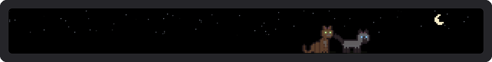
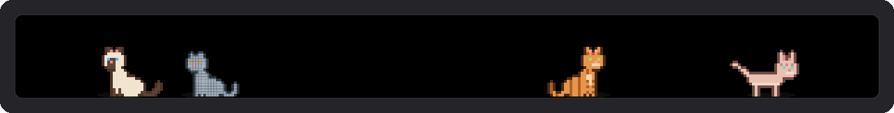
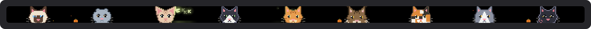
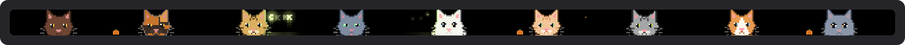
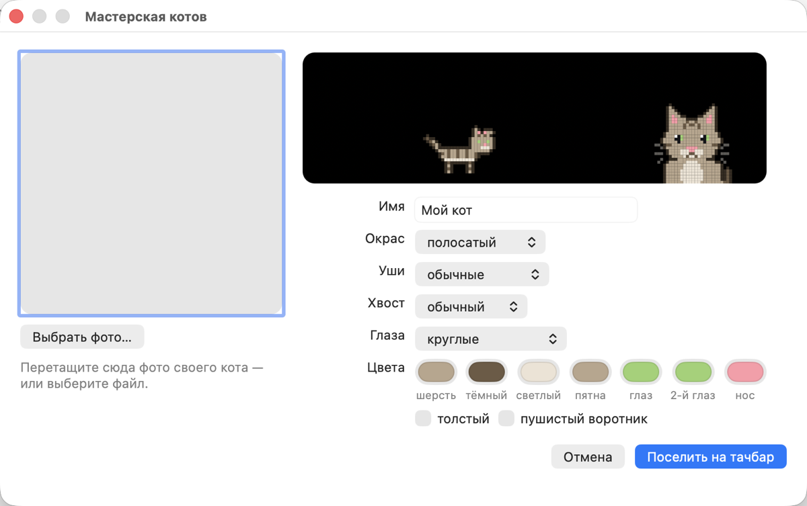

<p align="center">
  
</p>

<h1 align="center">TouchBar Cats</h1>

<p align="center">
  Десять пиксельных котиков живут на Touch Bar вашего MacBook Pro.<br>
  Ловят буквы, которые вы печатаете, и прибегают на «кс кс кс».
</p>

<p align="center">
  🇬🇧 <b>English speaker?</b> The English guide is at the very bottom of this page — <a href="#english">jump to English ↓</a>
</p>

<p align="center">
  <a href="https://github.com/tsanatsan/touchbar-cats/releases/latest/download/TouchBar-Cats.zip"></a>
</p>

<p align="center">
  
  
  
  
</p>

<p align="center">
  <a href="#как-установить">Как установить</a> ·
  <a href="#что-умеют-котики">Что умеют котики</a> ·
  <a href="#котики">Знакомьтесь</a> ·
  <a href="#свой-кот-из-фото">Свой кот из фото</a> ·
  <a href="#полезное">Полезное</a> ·
  <a href="#откуда-это">Откуда это</a> ·
  <a href="#english">English</a>
</p>

---

## Как установить

Займёт пять минут, программировать не нужно. Подойдёт любой MacBook Pro с Touch Bar — полоской-экраном над цифрами.

**1. Скачайте программу.** Нажмите оранжевую кнопку «Скачать» вверху. Скачается архив `TouchBar-Cats.zip`.

**2. Распакуйте.** Откройте папку «Загрузки» и дважды щёлкните по архиву. Рядом появится программа **TouchBar Cats** с котиком на значке. Если Safari уже распаковал архив сам, этот шаг можно пропустить.

**3. Перенесите её в «Программы».** Перетащите TouchBar Cats мышкой в папку «Программы» в левой колонке окна Finder.

**4. Откройте её в первый раз.** Дважды щёлкните по TouchBar Cats. Mac скажет, что не смог проверить программу. Это нормально: программа бесплатная, и автор не платил Apple за проверку. Нажмите **«Готово»**.

**5. Разрешите её запуск.** Откройте «Системные настройки» → **«Конфиденциальность и безопасность»** и пролистайте вниз до раздела «Безопасность». Там будет строчка про TouchBar Cats и кнопка **«Всё равно открыть»**. Нажмите её и подтвердите паролем или отпечатком пальца. Это нужно сделать только один раз.

**6. Разрешите котикам видеть клавиатуру.** Программа попросит доступ «Универсального доступа». Нажмите **«Открыть Системные настройки»** и включите переключатель рядом с TouchBar Cats. Без этого коты будут жить на тачбаре, но буквы летать не будут. Если окошко не появилось: «Системные настройки» → «Конфиденциальность и безопасность» → «Универсальный доступ».

**7. Готово!** Коты выбегут на тачбар с краёв. Попечатайте что-нибудь, а потом напишите «кс кс кс».

> **Нужны яркость, громкость и обычные кнопки?** Нажмите вместе **⌃ Control + ⌥ Option + ⌘ Command + T**. Коты разбегутся, и появится обычный тачбар. То же сочетание возвращает котов.

<details>
<summary><b>Как выключить или удалить</b></summary>

<br>

- **Выключить:** вверху экрана, в строке меню, есть значок с сидящим котиком. Нажмите на него и выберите **«Выйти»**.
- **Запускать вместе с Mac:** в том же меню откройте **«Настройки»** и включите **«Открывать при входе»**.
- **Удалить:** выключите программу, перетащите TouchBar Cats из «Программ» в корзину, а в «Универсальном доступе» уберите её строчку кнопкой «−».

</details>

## Что умеют котики

### Буквы-светлячки



Каждая буква, которую вы нажимаете, вылетает на тачбаре прямо над своей клавишей: «й» слева, «ж» справа. Буква светится, как светлячок, и подсвечивает шерсть котов вокруг. Ближайший игривый кот подкрадывается, виляет попой и прыгает. Поймал — буква рассыпается искрами, а кот довольно жуёт.

С 23:00 до 7:00 наступает ночь: на тачбаре загораются звёзды и луна, коты в основном спят, а глаза у них светятся в темноте.

### «кс кс кс»

Напишите «кс», и коты навострят уши. С каждым следующим «кс» они подходят ближе: поворачиваются мордочками к вам и растут, пока не прижмутся к стеклу. Там они моргают, тянутся к вам и трогают стекло лапкой с розовыми подушечками. Перестанете писать — через пару секунд коты отойдут и вернутся к своим делам.

### Backspace и «мяу»


Стёрли букву — она падает на пол, и ближайший кот сбивает её лапой. Напишите «мяу», и кто-нибудь ответит.

### Клубок



Напишите «клубок» или дважды коснитесь пустого места на тачбаре: сверху упадёт клубок, и коты будут его гонять.

### Игрушки

- **Лазерная указка.** Задержите палец на пустом месте тачбара — появится красная точка. Ведите пальцем, и коты будут за ней гоняться.
- **Мышка.** Иногда сама пробегает по краю, а ещё её можно позвать словом «мышка». Коты устраивают облаву; поймают не всегда.
- **Коробка.** Напишите «коробка» — коты по очереди залезают внутрь, из коробки торчат только головы. Толстые Пончик и Ириска застревают.
- **Миска.** Напишите «рыба» или «еда» — коты сбегаются к миске и едят.

### Котята

«Котики» → «Свои коты» → **«Завести котёнка»** и выберите маму или папу. Котёнок маленький, похож на родителя, ходит за ним хвостиком и спит рядом.

### Времена года и праздники

Зимой идёт снег, весной летят лепестки, летом порхают бабочки, осенью падают листья. На Новый год коты носят красные шапочки, на Хэллоуин у края стоят тыквы, светящиеся ночью, и летают летучие мыши, на День святого Валентина всплывают сердечки. Всё по дате на Mac, без интернета. Выключается в «Настройках».

## Котики

<p align="center">
  
  
</p>

| | Кто | Характер |
|---|---|---|
| **Рыжик** | рыжий полосатый, «М» на лбу | самый азартный охотник |
| **Уголёк** | чёрный | огромные жёлтые глаза, ночью светятся |
| **Фрак** | смокинг | белая манишка, белые лапки |
| **Ириска** | трёхцветная толстушка | соня, ходит вразвалочку |
| **Сима** | сиамская | тёмная маска, голубые раскосые глаза |
| **Пончик** | толстый серо-белый | почти всё время спит |
| **Добби** | сфинкс | лысый, огромные уши, морщинки |
| **Барон** | мейн-кун | самый большой, кисточки на ушах, грива |
| **Пуговка** | вислоухая | круглая мордочка, совиные глаза |
| **Снежок** | белый пушистый | глаза разного цвета |

Коты гуляют, умываются, спят клубком, потягиваются, зевают и трутся носами друг о друга. Того, кого вы гладите чаще всех, программа запоминает, и он сам подходит к пальцу.

## Свой кот из фото

<p align="center">
  
</p>

Поселите на тачбар своего настоящего кота. Значок с котиком в строке меню → **«Котики»** → **«Сделать своего кота из фото…»**:

1. Перетащите в окно фотографию своего кота или нажмите «Выбрать фото…».
2. Через секунду справа появится его пиксельный двойник: гуляет сбоку и смотрит из-за стекла.
3. Если что-то не так, поправьте: имя, окрас, уши, хвост, глаза, цвета (у каждого есть пипетка), «толстый» и «пушистый воротник».
4. Нажмите **«Поселить на тачбар»** — кот забежит с края и сразу начнёт охотиться на буквы вместе со всеми.

Программа сама находит кота на фото, вырезает его от фона, берёт цвет шерсти, глаз и носа и угадывает окрас: полосатый, трёхцветный, сиамский, смокинг, с белым, белый с пятнами или однотонный. Замечает даже глаза разного цвета. Вислоухость, лысость и толщину по одному фото не угадать — это переключатели в окне.

Всего на тачбаре может жить **до 18 котов**: десять встроенных и восемь своих (вместе с котятами). В «Котики» → «Свои коты» своего кота можно **изменить** — поправить или перерисовать по другому фото — или **удалить**. Для точности можно выбрать сразу несколько фото одного кота: окрас определится по большинству, цвета усреднятся.

### GIF тачбара

«Котики» → **«Записать GIF (5 секунд)»** — пять секунд тачбара сохранятся на рабочий стол как GIF в аккуратной рамке, готовый для чатов и сторис. Пока идёт запись, в углу тачбара горит красная точка (в GIF она не попадает).

## Полезное

- **Помидорный таймер.** Напишите «кот 25» — кот проспит 25 минут, над ним видно, сколько осталось, а потом он проснётся и позовёт на перерыв. «кот 0» отменяет.
- **Батарея.** Мало заряда — коты вялые и много спят. Подключили зарядку — кто-то перебирается к левому краю, где порт, и греется.
- **Статистика.** В меню «Котики» видно, сколько букв вы напечатали сегодня, сколько поймали коты, скорость печати в знаках в минуту и рекорды. Хранятся только счётчики, сами буквы нигде не сохраняются.
- **Звуки.** Тихое мурчание, когда гладите, «мррп», когда кот поймал букву, и «мяу» в ответ. По умолчанию выключены, включаются в «Настройках».

Фото разбирается прямо на вашем Mac встроенными средствами macOS (Apple Vision), никуда не отправляется и нигде не сохраняется. Программа запоминает только результат: цвета, окрас и имя. Вырезание кота от фона работает на macOS 14 и новее.

## Слова и касания

| Напечатайте | Что будет |
|---|---|
| любую букву | светлячок над её клавишей, коты охотятся |
| «кс», ещё «кс», ещё… | коты подходят к стеклу, с каждым разом ближе |
| «мяу» | кот отвечает |
| «клубок» | сверху падает клубок |
| «рыба» или «еда» | миска, все бегут есть |
| «коробка» | коробка, коты лезут внутрь |
| «мышка» | пробегает мышь |
| «привет» | коты машут лапой |
| «фу» | обижаются и отворачиваются |
| «спать» | все засыпают |
| имя кота | подходит только он |
| «кот 25» | помидорный таймер на 25 минут |
| Backspace | кот сбивает стёртую букву |
| пробел | облачко огоньков |

| Сделайте пальцем | Что будет |
|---|---|
| медленно проведите над котом | вы его гладите: жмурится, сердечки, говорит своё имя |
| быстро проведите | игривые коты гонятся за пальцем |
| коснитесь спящего | вздрагивает и просыпается |
| коснитесь мордочки у стекла | «буп» и румяные щёчки |
| дважды коснитесь пустого места | падает клубок |
| смахните клубок | клубок катится |
| дважды коснитесь клубка | кот уносит его в зубах |
| задержите палец над котами | любимчик подходит сам |
| задержите палец на пустом месте | лазерная указка |

**Меню.** Нажмите на значок с котиком в строке меню. Там всего четыре пункта:

- **«Обычный тачбар»** — то же, что ⌃⌥⌘T;
- **«Котики»** — статистика за сегодня, добавить или убрать кота, **«Свои коты»** (сделать из фото, завести котёнка, изменить, удалить), запись GIF, выбрать, кто живёт на тачбаре, вечная ночь или вечный день;
- **«Настройки»** — запуск при входе, тактильный отклик, полоса управления, жесты громкости и яркости, скрыть котов в текущей программе, сезоны и праздники, звуки, файл конфига и **язык: русский или английский**;
- **«Выйти»**.

## Это безопасно?

- Буквы только рисуются на тачбаре. Программа их никуда не записывает и не отправляет.
- В интернет программа не ходит вообще.
- В полях для паролей macOS сама прячет нажатия от всех программ, так что пароли на тачбар не попадут.
- Сочетания с ⌘, ⌃ и ⌥ светлячками не становятся.
- Батарею коты почти не едят: около 7% одного ядра с десятью котами на MacBook Pro M1, примерно как вкладка браузера с лёгкой анимацией. Нужно совсем ноль — включите обычный тачбар по ⌃⌥⌘T, коты встанут на паузу.
- Фото для своего кота разбирается прямо на Mac и не сохраняется.
- Весь код открыт, его можно прочитать в этом репозитории.

## Откуда это

Я хотел вырастить на тачбаре что-нибудь живое. Самый простой путь к тачбару оказался в [MTMR](https://github.com/Toxblh/MTMR) («My TouchBar My Rules») Антона Пальгунова: это открытая программа, которая уже умеет занимать весь тачбар. Я взял её за основу, вырезал почти всё, что в ней было — автообновление, погоду, курсы валют, лишние разрешения — и поселил туда котов.

**Огромное спасибо Антону Пальгунову и всем, кто делал MTMR, за то, что выложили код в открытый доступ.** Без них этой забавы бы не было.

TouchBar Cats я раздаю точно так же: бесплатно и с открытым кодом под лицензией [MIT](LICENSE). Берите, меняйте, дарите своим котам.

<details>
<summary><b>Для разработчиков: сборка из исходников и настройка</b></summary>

<br>

Xcode не нужен, хватит Command Line Tools:

```bash
xcode-select --install
```

```bash
git clone https://github.com/tsanatsan/touchbar-cats.git
cd touchbar-cats
make run
```

`make install` копирует программу в «Программы», `make release` собирает универсальный архив для Apple Silicon и Intel, `ARCH=x86_64 make` — сборку только под Intel. Подпись сборки привязана к идентификатору программы, поэтому разрешение «Универсального доступа» не слетает после пересборки.

**Конфиг** лежит в `~/Library/Application Support/MTMR/items.json`, формат тот же, что у MTMR. По умолчанию там только коты:

```json
[
  { "type": "cats" }
]
```

Котов можно сузить и поставить рядом другие элементы MTMR. Например, громкость и яркость: здесь это одна кнопка, как в полосе управления Apple — коснулся и ведёшь пальцем.

```json
[
  { "type": "cats", "width": 760 },
  { "type": "brightness", "align": "right" },
  { "type": "volume", "align": "right" }
]
```

Остальные виджеты MTMR описаны в [его README](https://github.com/Toxblh/MTMR#readme).

**Где что лежит:**

- `MTMR/Cats/` — коты: породы и окрасы, пиксельные позы, поведение, отрисовка со светом от букв, элемент тачбара, мастерская своих котов и разбор фото через Vision;
- `MTMR/Widgets/ControlStripSliderItem.swift` — громкость и яркость в стиле Apple;
- `MTMR/GlobalHotKey.swift` — сочетание ⌃⌥⌘T;
- `build-local.sh` — сборка без Xcode.

Каждый кот собирается в маленькую картинку в памяти и выводится на тачбар одной командой. Тачбар обновляется 60 раз в секунду, только когда что-то происходит (летят буквы, касание, прыжок, «кс кс»), на батарее — 30. Пока коты просто гуляют — 20, когда все отдыхают — 10, а на паузе и пока экран спит — раз в секунду.

</details>

## Ограничения

- Проверено на MacBook Pro 13″ с M1 и macOS 26 Tahoe. Версия для Intel собирается, но на Intel-Маке не проверялась.
- Буквы стоят точно над клавишами на 13-дюймовом MacBook Pro: у него Esc слева и Touch ID справа от тачбара. На других моделях — примерно.
- Программа работает с тачбаром через приватные интерфейсы macOS. По словам разработчика BetterTouchTool, в macOS 27 Apple закрыла часть этого доступа для сторонних программ (как минимум для симулятора тачбара), так что на новых версиях системы что-то может перестать работать.

---

<h2 id="english">English</h2>

<p align="center"><a href="https://github.com/tsanatsan/touchbar-cats/releases/latest/download/TouchBar-Cats.zip"><b>⬇ Download TouchBar Cats</b></a></p>

**TouchBar Cats** puts ten pixel cats on your MacBook Pro Touch Bar.

- **Letters become fireflies.** Every key you press flies up on the Touch Bar right above its key and lights up the cats around it. The nearest playful cat stalks it, wiggles and pounces. At night (23:00–7:00) there are stars and a moon, and the cats' eyes glow.
- **Type «кс» or `ks` again and again** — the Russian way to call a cat. With each one the cats come closer, turn to face you and press their noses and paws against the glass.
- **Backspace** drops the last letter and a cat swats it away. Type `meow` and a cat answers. Type `yarn` or double-tap an empty spot to drop a ball of yarn.
- **Touch them:** slowly move a finger over a cat to pet it, swipe fast to make them chase, tap a sleeping cat to wake it, tap a face at the glass to boop it.
- **Ten cats:** ginger tabby, black, tuxedo, chubby calico, Siamese, chubby grey-and-white, hairless Sphynx, Maine Coon, Scottish Fold and an odd-eyed white fluffball. Your favourite one comes to your finger by itself.
- **Your own cat from a photo:** Cats → *Make your own cat from a photo…*, drop a picture and get a pixel twin with the same coat, colors and even odd eyes, then tweak it and move it onto the Touch Bar. Up to 18 cats in total. The photo is analyzed on your Mac with Apple Vision and never stored or sent.
- **Toys and words:** hold a finger on an empty spot for a laser pointer; type `fish`/`food` (bowl), `box`, `mouse`, `hello`, `bad`, `sleep`, a cat's name, or `cat 25` for a 25-minute pomodoro.
- **Kittens** that follow their parent, **seasons and holidays** (snow, leaves, Santa hats, Halloween pumpkins), quiet **sounds** (off by default).
- **Useful bits:** sleepy cats on low battery and a cat warming up by the charging port, typing stats in the menu, and a 5-second **GIF** of the Touch Bar saved to the Desktop.
- **⌃⌥⌘T** swaps to the regular Touch Bar and back.

**Install:** download the zip, unzip it, drag **TouchBar Cats** into Applications and open it. macOS will say it can't verify the app — it's free and not notarized — so press **Done**, then go to **System Settings → Privacy & Security** and click **Open Anyway**. Finally allow it in **Privacy & Security → Accessibility** so the cats can see your key presses. Letters are only drawn, never stored or sent, the app makes no network requests at all, and password fields are hidden by macOS Secure Input. The cat icon in the menu bar has everything else: the regular Touch Bar, the **Cats** menu (letters caught today, add or remove cats, night mode), **Settings** (open at login, haptics, Control Strip, gestures, config, **language: Russian or English**) and **Quit**.

**Where it comes from:** I took [MTMR](https://github.com/Toxblh/MTMR) by Anton Palgunov — open source and the easiest way into the Touch Bar — cut almost everything out and moved the cats in. Huge thanks to Anton and all MTMR contributors for sharing their code. TouchBar Cats is shared the same way: free and open source under the [MIT](LICENSE) license.

Tested on a 13″ M1 MacBook Pro with macOS 26. Build from source: `make run` (Command Line Tools only).
